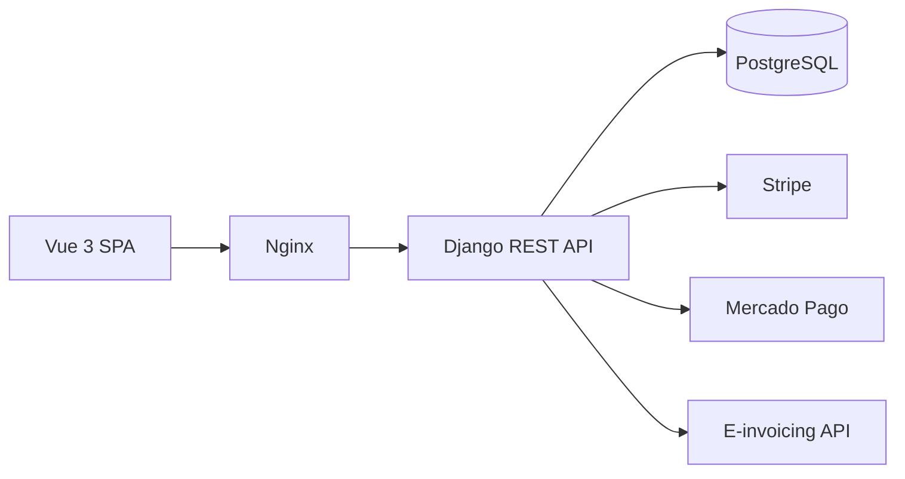

# Restaurant management SaaS

> Technical overview. The source code is in a private repository.

SaaS for bars and restaurants: point of sale, tables, digital menu, delivery, stock with recipes, cash register, reports and Brazilian e-invoicing (NF-e / NFC-e). I built it end to end: data model, API, frontend and deploy.

## Stack

| Layer | Technology |
|---|---|
| Backend | Python, Django, Django REST Framework, JWT |
| Frontend | Vue 3, Pinia, Vuetify, Chart.js |
| Database | PostgreSQL |
| Payments | Stripe (subscriptions), Mercado Pago (PIX) |
| Infrastructure | Docker Compose, Nginx, Gunicorn, Linux |

## Architecture

## Problems and solutions

**Several businesses on the same system**
- *Problem:* each establishment can only ever see its own data.
- *Solution:* multi-tenant model in a shared database. Every business table carries the tenant, and the API scopes every query to the logged-in user's tenant.

**Access tied to the subscription**
- *Problem:* access has to follow the payment status without manual work.
- *Solution:* Stripe subscriptions with signed webhooks that update the account status (active, grace period, cancelled). An API permission blocks access when the subscription isn't valid.

**Stock under simultaneous sales**
- *Problem:* two sales at the same moment could read the same stock quantity.
- *Solution:* stock updates run in database transactions with row locks. Products with recipes deduct their ingredients, and every stock and cash change is stored as a movement record, so balances can be audited.

**Session dropping when returning to the tab**
- *Problem:* several requests renewed the expired token at the same time, and the session dropped.
- *Solution:* the renewal became a single shared operation. Concurrent requests wait for it and reuse the new token.

**Outdated orders in background tabs**
- *Problem:* tabs in the background showed delivery orders that had already changed.
- *Solution:* the list reloads when the tab becomes visible again.

## Next steps

Expand the automated tests (tenant isolation, stock and payment webhooks) and run them in CI.
